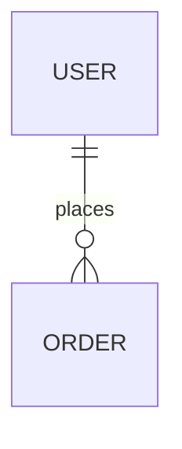

# 文档站（`/docs`，主站一等公民页面）

> 历史：原独立仓库 `ClosedWHU/Luotopia-Docs`（Docusaurus 3），2026-10 经
> `git subtree` 并入本仓库后改为**主站自渲染**（无文档框架）。同月完成
> 公开/私有拆分：本仓只保留 **user + client** 两个公开分区；**server 与
> ebike** 开发文档随闭源代码迁入私有仓 `ClosedWHU/Luotopia-Docs`（GitHub
> 阅读或本地构建，无公开部署）。
> `docs.whu.sb` 旧域名由 `functions/_middleware.ts` 301：user/client 的历史
> URL 一跳解析到对应页面（映射：`src/config/docs/redirects.mjs`），
> server/ebike 的旧 URL 落到 `/docs/` 首页（公开侧已无对应页面）。

两个**分区**、两套侧边栏（侧栏顶部切换器）：

| 路由 | 内容 | 源目录 |
|------|------|--------|
| **`/docs/user`** | 用户操作指南 | `src/content/docs/user/` |
| **`/docs/client`** | 客户端开发 | `src/content/docs/client/` |

`/docs/` 是文档首页（主站 PageHeader + 分区玻璃卡）。主站 Navbar（「文档」）
与 Footer（「文档中心」）都有入口。

## 架构（为什么没有文档框架）

Starlight 的两个硬约束曾迫使它独立成项目：它的 base 是 Astro 全站 `base`；
它的 locale 表从全站 `i18n` 推导（主站 10 语言会把每篇中文文档复制十份）。
独立/嵌套项目又带来第二套外观、第二个 node_modules、构建合并与 dev 代理。
文档内容本身是**零 MDX、零框架特性**的纯 markdown，需要的只是：侧栏树、
TOC、prev/next、告警框、mermaid 图——全部用主站既有约定实现（`<details>`
披露、`onPageSetup`、玻璃卡片、lt-* token），因此框架被整体移除。
**站内搜索是有意不做的**（曾短暂接过 Pagefind，后按产品决定移除）。

渲染链：`src/content/docs`（content collection，schema 见
`src/content.config.ts`）→ `src/pages/docs/[...slug].astro`（薄路由）→
`DocsPage.astro`（外壳：侧栏/文章/TOC/翻页/编辑链接）→ `docs.css`（prose
与外壳样式，全部 var(--lt-*) 引用，随主站调色板与暗色自动联动）。
文章面板与法律文档同款（`--lt-reading-panel-bg` 高不透明阅读面板，
`rounded-group`）；侧栏与 TOC 是无背景的安静 chrome。

## 本地开发

```bash
npm install
npm run dev        # 一个 dev server 就是全站：http://localhost:4321/docs/
```

## 构建与部署

```bash
npm run build   # astro build，全站（营销页 + 文档）一次产出
```

随主站一体部署（Cloudflare Pages git 集成，推送 main 即上线）。镜像构建
（`MIRROR_ASSETS_ONLY=1`）照常包含文档页面——镜像的 HTML 全部被桩化跳回
主域，文档自然包含在内。

## 配置要点

- **每篇文档 frontmatter 都带 `slug: docs/<路径>`**（迁移时统一写入）：路由
  params 与导航解析都读它，URL 单一来源
- 内容里的站内链接一律写**绝对 URL**（`/docs/client/setup/`，可带 `#锚点`）：
  Astro 的相对 `.md` 链接自动转换在自定义 markdown processor 下不生效，
  迁移时已把全部相对 `.md` 链接与 Docusaurus `pathname:///` 链接重写为绝对
  URL；构建后的链接扫描会拦住回归。**指向 server/ebike 的链接已在拆分时
  去链留文**（私有内容不留公开死链）
- 侧边栏结构：`src/config/docs/sidebar.mjs`（生成自旧 `sidebars*.ts` +
  `_category_.json`，已裁剪为 user/client 两区）由
  `src/config/docs/navigation.ts` 解析——**叶子目录是 `autogenerate`**：
  目录里新增页面无需改配置，顺序/名称由 frontmatter `sidebar.order` /
  `sidebar.label` 决定；client 分区无子目录层级，全部 autogenerate
- 重定向：`src/config/docs/redirects.mjs`（仅剩 user/client 相关的 3 条历史
  键；docs 相对路径）。两个消费方各自加 `/docs` 前缀：astro.config 的站内
  `redirects`，和 middleware 的 `docs.whu.sb` 301
  （`functions/lib/docs-redirects.ts`，含 server/ebike → `/docs/` 的前缀兜底）
- markdown 管线：全站 `markdown.processor: unified({...})` 注入
  `remark-github-blockquote-alert`（GitHub 风格告警，含按类型的同色淡底 +
  跟随站点 `.dark` 的调色钉扎）与 `src/plugins/rehype-pre-mermaid.mjs`；
  代码高亮 `rehypeShiki` 双主题（github-light/dark，`.dark` 切换在 docs.css）。
  主站自身不渲染 markdown（legal 是 .md.ts 原文端点），该设置实际只作用于文档
- mermaid 运行时在 `DocsPage.astro` 的 `onPageSetup` 里懒加载（仅含图页面
  下载 ~1MB 运行时）；切换明暗后已渲染的图不自动重着色（刷新即可）
- 语言协商：`/docs` 在 middleware 的 `NON_PAGE_PREFIXES` 里——文档只有
  zh-Hans，永不生成 `/en/docs`；hreflang 对路由表之外的路径只发 x-default
  （`ui.ts` 的 `hreflangAlternates`）
- 标题单一来源：frontmatter `title` 即页首 H1，正文不再写 `# H1`
- 「编辑页面」链接指向本仓库 `src/content/docs/<file>`（index 页会探测真实
  文件名）；页面不显示最后更新时间

## 维护

| 改什么 | 改哪里 |
|--------|--------|
| 用户怎么用 App | `src/content/docs/user/` |
| Flutter 开发 | `src/content/docs/client/` |
| Go / 部署 / 电单车 | **私有仓 `ClosedWHU/Luotopia-Docs`**（server/ebike 分区；其 README 有结构与约定） |

### 推荐侧栏顺序

**用户** `1→11`：概览 → 开始 → 账户 → 课表 → 成绩 → 校园 → 日程 → AI → 设置 → 隐私 → FAQ  

**客户端** `0→19`：概览 → 环境 → 架构 → 目录 → Feature 约定 → 状态 → UI → 多端 → 认证 → API → 校园 → 教务认证 → 子应用 → WebView → 功能地图 → 更新 → 测试 → 已移除与迁移 → 云控 → 声明式 UI  

废弃协议与目录迁移：客户端 [已移除与迁移](../src/content/docs/client/removed-and-migrated.md)（服务端对应页在私有仓）。

### 近期易漂移点（改代码时记得同步文档）

| 主题 | 用户 | 客户端 |
|------|------|--------|
| 安装包检查 / prerelease | `user/settings.md`、`faq.md` | `client/updates.md`、`features.md` |
| 热更新解析脚本 | 同上 | `updates.md` |
| 校巴卡片 vs 网格 | `user/campus.md` | `client/campus.md` |
| 导航 Tab 默认/隐藏 | `getting-started.md`、`settings.md` | `NavigationSettings` 代码 |
| SnackBar 在弹窗上 | — | `client/components.md` |
| 业务服 vs 官网 URL | `settings.md` | `auth.md`、`api-integration.md` |
| 校园子应用清单 | `user/campus.md` | `campus-sub-apps.md`、`features.md` |
| 热更新影响导入 | `timetable.md`、`scores.md` | `updates.md` |
| 官网 / Releases | `privacy-and-data.md` | `updates.md` |
| Feature 迁址 | — | `feature-architecture.md` |
| SDUI 组件词表 / token | — | `sdui.md`（`appSduiComponentReference()` 是机器可读来源） |

涉及服务端的漂移点（模块边界、校园代理、外部面等）随 server 文档一起在
私有仓维护。

### 开源文档 vs 闭源代码

公开文档只有用户指南与客户端开发两区。写作时：

- 要：使用步骤、客户端架构与约定、协议与边界、联调步骤、工程约定  
- 不要：密钥、可复现的第三方逆向、未公开 API、大段闭源实现、后端部署细节  

服务端与电单车文档已整体转入私有仓（完整策略文档
`public_docs_policy.md` 随 server 分区存放于私有仓）。公开侧新增页面时
以上边界仍然适用。

### Mermaid 图

````md

````

注意：ER 实体属性块内**不要**写 `%%` 注释（会破坏解析）。复杂注释写在图外。
